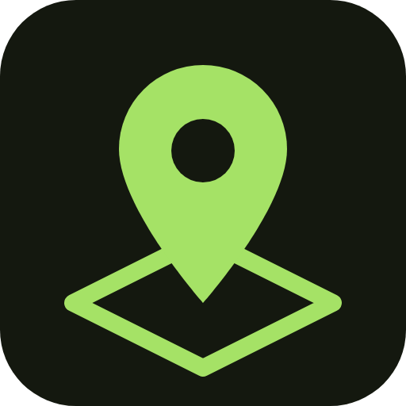
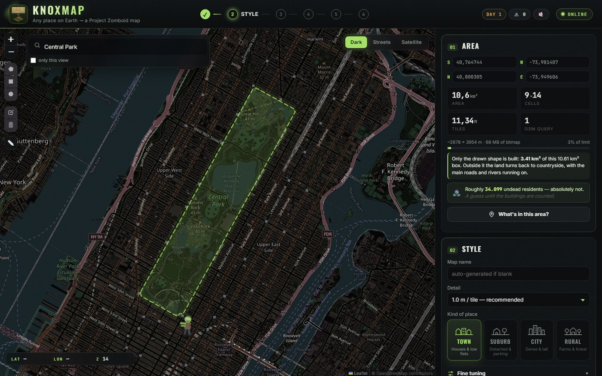
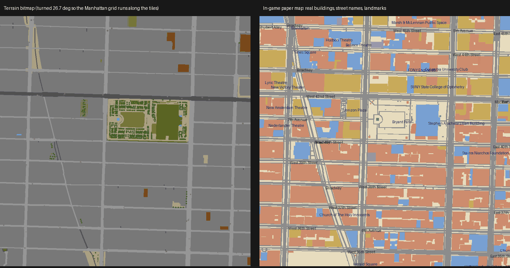
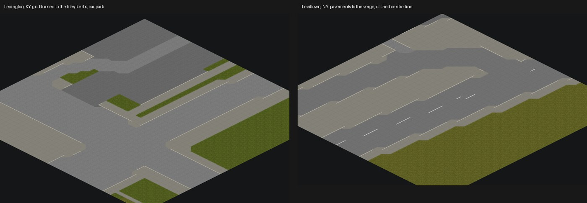
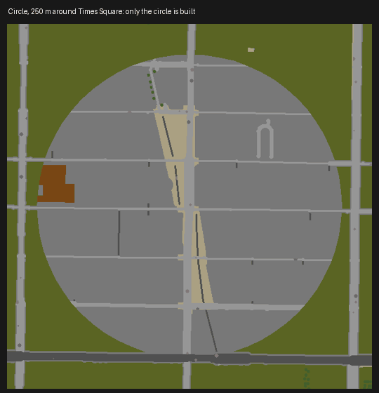
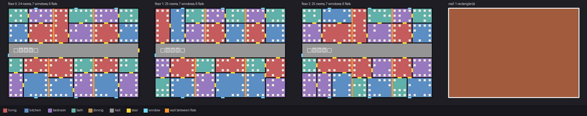

<p align="center">
  
</p>

<h1 align="center">KnoxMap</h1>

<p align="center"><strong>Draw any place on Earth. Play it in Project Zomboid.</strong></p>

<p align="center">Made by <strong>euclid80tr</strong> · <a href="https://discord.gg/ePM8dSxPm7">Discord</a></p>

<p align="center">
  
  
  
  
  
</p>

> [!IMPORTANT]
> KnoxMap is an **unofficial fan project**. It is not made, endorsed or supported
> by The Indie Stone. It contains no game files: it builds maps from your own copy
> of Project Zomboid. See [Disclaimers](#disclaimers).

KnoxMap turns a real place into a playable Project Zomboid map, from one window:

**choose an area → terrain → furnished buildings → compile → install into the game**

It reads the real streets, buildings, water, parks, railways and land use from
[OpenStreetMap](https://www.openstreetmap.org), fits every building onto its real
footprint with rooms, stairs, furniture and lights, spawns zombies where people
actually lived, and installs the result as a mod.

<p align="center">
  
  <br/><sub>Choosing an area: Central Park's real boundary, straight from a search. Map tiles © OpenStreetMap contributors.</sub>
</p>

## What you get

- **The real street plan.** Roads at their real widths, with pavements, kerbs
  and centre lines. The map is turned so the town's main street grid runs along
  the game's tiles, so streets are straight lines, not staircases. Or, with
  *Knox County roads*, every road laid in straight runs and 45-degree corners
  like the game's own map, the town bent gently to fit.
- **Cars** parked along the streets, in rows in the car parks and on the
  drives, and **petrol stations** with a forecourt and pumps that hold fuel.
- **Water, bridges and railways.** Seas and harbours, rivers with square
  railed bridges, canals, piers and railway lines. A road or railway over
  another is a real overpass: ramps up to a railed deck, the road below
  running on underneath.
- **Monuments** as themselves: arches, columns, statues on paved squares and
  fountains, instead of little houses.
- **Buildings you can walk into**, every one on its real footprint. Houses with
  bedrooms upstairs; blocks of flats with a corridor and separate flats; shops,
  schools, churches, clinics, offices and factories laid out as what they are.
  Every room has a light switch, every staircase is clear, and roofs follow the
  footprint.
- **Real heights, up to 31 storeys**, taken from OpenStreetMap where they are
  mapped and from the neighbours where they are not.
- **Working lifts** in buildings of five storeys or more, when the
  [Elevators](https://steamcommunity.com/sharedfiles/filedetails/?id=3780306632)
  mod is enabled (optional).
- **Buildings that are what they really are.** The pizza place, the bank, the
  pharmacy or the hotel OpenStreetMap has in a building becomes the game's own
  rooms for it, fitted out like vanilla's: a dining room and a pizza kitchen,
  aisles of shelving and a till, guest rooms upstairs.
- **Erika's Tiles, if you have it.** With
  [Erika's Tiles](https://steamcommunity.com/workshop/filedetails/?id=3346506593)
  subscribed (and Setup run again), shops get glass shop fronts in painted
  frames with glass doors and a sign over them, drinks machines, posters and
  bookcases inside; homes hang its far larger range of paintings, posters and
  mirrors and pot its plants; main streets get speed limit signs. Maps made
  that way list it as a requirement.
- **Start where you like.** With the optional
  [Spawn Selector](https://steamcommunity.com/sharedfiles/filedetails/?id=3772052709) mod, the map's
  named buildings and places appear as starting points.
- **Buildings that look their part**: wall materials by neighbourhood; windows
  that suit the building - sash windows on houses, tall panes on flats, glass
  panels on towers and shop fronts, stained glass on churches - spaced the way
  that kind of building is, with blinds or curtains to match.
- **The real map in your pocket.** The in-game map (M) shows the real streets,
  buildings, water and woods, with real street names and landmarks labelled.
- **Zombies where the people were.** The spawn map comes from an estimate of who
  lived and worked in each building, and every part of it is adjustable.
- **Any shape you like**: a rectangle, a polygon, a circle, a freehand outline,
  or a place's real boundary.

<p align="center">
  
  <br/><sub>Midtown Manhattan around Bryant Park: the terrain (left), turned 26.7° to the street grid, and the paper map
  players carry in game (right). Map data © OpenStreetMap contributors.</sub>
</p>

<p align="center">
  
  <br/><sub>Streets as KnoxMap lays them, drawn with the game's own tiles by <code>tools/render_ground.py</code>
  (not an in-game screenshot). Tile artwork © The Indie Stone.</sub>
</p>

## Quick start

**You need:** Windows 10 or 11 · **Project Zomboid Build 42** installed through
Steam · an internet connection. Python is optional: if your PC doesn't have it,
setup downloads a private copy into the KnoxMap folder.

**On Linux or macOS** it is `./setup.sh` once and `./knoxmap.sh` after that,
and you need your own 64-bit Python 3.10+. Everything works; Compile runs the
map tools through Wine, which a PC playing Project Zomboid through Proton
already has. See [LINUX.md](LINUX.md).

1. **Download KnoxMap** from
   [Releases](https://github.com/spytheeuclidean-a11y/knoxmap/releases/latest) —
   `KnoxMap-v…-windows.zip` on Windows, `…-linux.tar.gz` or `…-macos.tar.gz`
   elsewhere — and unpack it anywhere. (Or `git clone` it for the latest
   changes.)
2. **Double-click `KnoxMap.exe`.** The first time, it runs setup for you, which:
   - uses your Python 3.10+ if you have one, or downloads the official python.org
     build (checked against its fingerprint) into the folder if not,
   - creates a private Python environment inside the KnoxMap folder,
   - downloads the free [PZ Mapping Tools](https://github.com/Unjammer/PZ_Mapping_Tools),
   - downloads the map compiler from this repository's releases and checks its fingerprint,
   - finds your Project Zomboid install and copies the tile artwork the map tools
     need **from your own copy of the game** (games or Workshop mods on another
     drive: name it when setup asks, or later under *Settings > Steam libraries*),
   - adds the rules for kerbs, road markings and Build 42 trees to the map tools.

   It takes a few minutes, once. After that `KnoxMap.exe` opens straight away.
3. **Make a map** in the window that opens:
   1. **Choose an area** (see below). Start small, a few streets, while you get a
      feel for it.
   2. Pick a **kind of place** (Town, Suburb, City, Rural) and press **Generate map**.
   3. Under *Finish the map*: **Build** → **Compile** → **Install**.
4. **In Project Zomboid**: enable your map in **Mods** (and **Elevators** too, if
   you want working lifts), then start a **new** game and choose it. Existing
   saves never pick up new maps.

If anything is missing, a *Setup incomplete* panel in the app says exactly what
and how to fix it. You can run `Setup.bat` again at any time; it only does what
is still needed.

## Choosing an area

| Tool | How |
|---|---|
| **Search** | Type a place and press **Enter**. Pick a result for a box around it, or its **OUTLINE** button for the place's real boundary: a park, a district, a whole town. |
| **Rectangle** | Drag a box on the map. |
| **Polygon** | Click point by point round any outline; click the first point to finish. |
| **Circle** | Drag out a radius from a centre. |
| **Freehand ✎** | Drag round what you want. The line is smoothed into a clean outline. |

A shape is built only inside itself. The map still covers the shape's whole
bounding box (the game needs whole cells), but outside the shape the land turns
back to countryside, with the main roads and rivers running on so the town is not
an island.

You can also open KnoxMap straight to a place: add `?q=Bryant Park, New York` to
the address, and `&outline=1` to take its real boundary.

<p align="center">
  
</p>

## Map data sources

**Auto** reads a cached Geofabrik regional extract when pyosmium is installed,
and falls back to Overpass if the extract is unavailable. A regional file can
be hundreds of megabytes; the first download and scan take longer than a small
online query. The reading stage reports object counts, not a percentage of
the compressed file. Rebuilding a generated map reuses its saved map data.

**Overpass API** downloads just the selected area. It keeps completed tiles,
respects failed servers' cooldowns and retries at most three passes. Server
roots entered in Settings are expanded to interpreter URLs; aliases of the
same public service count as one server. A responding status page does not
guarantee a free query slot. If all servers are unavailable, choose Auto or
Geofabrik rather than repeatedly starting the same online download.

## Tuning a map

Open **Fine tuning** under *Style*:

| Setting | What it does |
|---|---|
| **Fill gaps from Overture** | 1 adds the buildings OpenStreetMap has not got, from [Overture Maps](https://overturemaps.org) — which is OSM plus machine-detected roofprints, under the same ODbL licence. Off by default: where OSM is complete it adds sheds (60 buildings on a German town), and where OSM is thin it nearly trebles the place (761 on a Turkish one). Needs DuckDB — `python -m pip install duckdb` into KnoxMap's own `.venv`. The fetch takes a few minutes and is then cached with the map. |
| **True map generation** | 1 rebuilds every address the map has. 0 keeps the real roads, rivers, woods and terrain but lays the housing out for the game: about half the ordinary houses are left out and the ones that stay grow into the gap, so a street is proper homes with yards rather than rows of one-room boxes. Worth turning off at 2 m a tile or more, and on a town mapped at European density. |
| **Guaranteed rifle** | 1 leaves one military rifle somewhere on the map: an army building if there is one, else the police station, else a gun shop, else a house on the edge of town. A real town has no army checkpoints in it, so without this the game's rifles may have nowhere at all they could spawn. |
| **Zombies per person** | How many zombies each person who lived or worked there becomes. |
| **Living space** | Floor area per person. Lower means more crowded buildings and more zombies. |
| **Horde cap** | The most zombies one 10×10-tile spot can hold. Vanilla towns peak at 10. |
| **Flats above / Flats chance** | How readily large untagged buildings become blocks of flats. |
| **Tallest building** | The storey limit, up to 31. Real heights from OpenStreetMap are used where mapped. Tall cities take much longer to compile. |
| **Straighten streets** | 1 turns the map so its main street grid runs along the tiles; 0 keeps north straight up, with diagonal streets as staircases. |
| **Knox County roads** | 1 lays every road in straight runs along the tiles and on 45-degree diagonals, like the game's own map: curves become straight sides with 45-degree corners, and the buildings, parks and car parks move with their streets and stand upright beside them. Streets end up a little way off their real places. 0 draws roads as mapped. |
| **Woodland**, **Parking**, **Room size** | What they say. |
| **Seed** | The same area and seed always give the same town. |

After **Build**, a **Zombie census** shows the estimated residents, workers and
zombies. Change the zombie settings and press **Recount** to redraw them in a
second without rebuilding, then compile again so the game sees the change.

<p align="center">
  
  <br/><sub>A generated block of flats, floor by floor: a corridor, flats outlined in orange, stairs, doors and windows.</sub>
</p>

## Good to know

- **KnoxMap in your language.** `lang/english.txt` holds every line the window
  says, as `English = English`. Copy it, name the copy after the language
  (`russian.txt`, `deutsch.txt`, `turkce.txt`), translate the right-hand side
  of each line, and pick it from the menu at the top of the window. Lines left
  in English stay English, so you can translate as much or as little as you
  like, and `python tools/make_lang_template.py` writes the English file again
  after an update. Translations are welcome as pull requests.
- **Build a building yourself, and send it to anyone.** Under **Hand-built
  buildings** you can draw a house, a police station or a shop room by room
  and have the generator stamp it onto the map wherever it has one of those,
  instead of laying out its own. **Share** writes the whole thing - the
  building, the drawing it was made from and what it stands in for - into one
  `.knoxbuilding.json` file, and **Take one in** reads one somebody sent you.
  Send one to the [KnoxMap Discord](https://discord.gg/ePM8dSxPm7) and it can
  go into the library that ships with KnoxMap, with your name on it, for
  everybody's maps.
- **Fresh loot without a new save.** The game fills a container once and
  remembers it, so a map installed again keeps what it rolled the first time.
  In game, right-click the ground and pick **Reset loot** - this building, or
  everything within 30 tiles - and those containers are filled again from
  their loot tables. It asks first, because what is in them is thrown away.
  Single player only.
- **An update does not mean starting over.** Each step of a map records the
  KnoxMap that ran it. Open a map again under *Your maps* and, if a newer
  release changed anything it uses, the window offers to upgrade it and runs
  only the steps that changed - often just **Install**, which is all the cars
  and the in-game map need.

- **Size and time.** A few square kilometres is a comfortable town. Compiling is
  the slow part: a 600 × 600 m city block takes a minute or two, and several
  minutes with 31-storey towers.
- **North may not be up.** With *Straighten streets* on, the map is turned to
  its street grid, often by 20-45°. The in-game map is turned the same way.
- **Maps are cached.** Regenerating the same area reuses its OpenStreetMap
  download, so trying different settings is quick.
- **A map is only as good as OpenStreetMap's data for that place.** Well-mapped
  city centres come out best; rural areas often lack buildings entirely.
- **Where maps go.** Installed maps are copied into `%USERPROFILE%\Zomboid\mods`
  unless you choose another Zomboid folder, in Setup or under **Where maps are
  installed** in the app. Then launch the game with `-cachedir=<that folder>` so
  it sees them. Project files stay in KnoxMap's `output\` folder.
- **KnoxMap updates itself.** When a new version is released, it downloads in
  the background and the top of the window says **Restart to update**; closing
  and opening KnoxMap installs it too. Your maps, logs and settings are kept.
  To turn it off, add `"auto_update": false` to `knoxmap_config.json`.
- **Discord status.** What KnoxMap is doing - Planning a map, Scooping data
  from osm, Mapping, Compiling - shows on your Discord profile, where your
  friends list can see it. To turn it off, add `"discord_presence": false` to
  `knoxmap_config.json`, or start KnoxMap with `KNOXMAP_NO_DISCORD=1`.

## Compatibility

- **Project Zomboid Build 42 only.** Build 41 cannot load these maps, and setup
  warns you if your game looks like Build 41.
- **The map compiler is a Windows program.** On Linux and macOS it runs
  under Wine ([LINUX.md](LINUX.md)); every other step is Python and needs
  nothing. Without Wine you can still compile by hand in WorldEd.
- **Mods:** the generated map is an ordinary map mod. Lifts need the optional
  [Elevators](https://steamcommunity.com/sharedfiles/filedetails/?id=3780306632)
  mod; without it they are just closed doors. With the optional
  [Spawn Selector](https://steamcommunity.com/sharedfiles/filedetails/?id=3772052709) mod you can pick
  any landmark of the map as your start. Other map mods that occupy the same
  area of the world may conflict.
- **Multiplayer and dedicated servers:** not tested.

## Known limitations

KnoxMap is new, and most of it has been checked by tools rather than by
playing. Help is very welcome here, especially screenshots from the game.

- **Not yet confirmed in game:** that kerb tiles face the right way, that lifts
  carry players with the Elevators mod, how labels in non-Latin scripts appear
  on the in-game map, and how 31-storey towers play.
- **Winding old towns** have no single street grid, so their streets still step
  across the tiles where they turn.
- **Very large buildings** (over 200 tiles across by default) are skipped.
- **Overpasses** are lifted one or two storeys on Build 42's ramp tiles, which
  carry players and cars; not yet driven in game. Big interchanges come out
  busy, and tunnels are left out.
- **Turned buildings** keep their real angle with stepped walls unless they are
  within *Square up buildings* degrees of the grid (15 by default; 45 stands
  every building upright).
- **Interiors are generic:** rooms suit what a building is, but they are not the
  real layout of any real building.
- **Big maps take time.** Downloading, and above all compiling, a large or tall
  city can take many minutes; the map compiler uses one process at a time.

## Troubleshooting

| Problem | Fix |
|---|---|
| Setup fails | The whole run is written to `logs/setup.log`. Run `Setup.bat` again; if it fails the same way, post that file. |
| Setup cannot find Project Zomboid | It asks for the folder: paste the `ProjectZomboid` folder from your Steam library. |
| Setup says the game looks like Build 41 | In Steam: right-click Project Zomboid → **Properties → Betas** → pick the Build 42 branch, then run `Setup.bat` again. |
| *OSM query failed* | The free OpenStreetMap servers are busy. Wait a minute and try again, or choose a smaller area. |
| The map is not in the game | Enable it under **Mods**, then start a **new** game. |
| The window is blank | Install the [Microsoft Edge WebView2 runtime](https://developer.microsoft.com/microsoft-edge/webview2/) (built into Windows 11). |
| It opened in my browser instead of a window (Linux) | That is the whole app — nothing is missing. For a window of its own, install a desktop toolkit; see [LINUX.md](LINUX.md). |
| KnoxMap closes straight away | It shows a message and writes the error to `logs/knoxmap.log`. Running `Setup.bat` again fixes most causes. |

### Reporting a problem

Everything KnoxMap does is written to the `logs` folder: `knoxmap.log` for the
app (with a short description of your PC at the top of each run), `setup.log`
for Setup, and `worlded/` for the map compiler's own output.

When something fails, the message in the app carries an id such as
**E-7F3A2C**, the same id that sits beside the full error in the log.

1. Click **Save report** on the error, or **report a problem** at the top of
   the window. It saves `KnoxMap-report-….zip` into `logs` and shows it in
   Explorer. The zip holds the logs and the settings of your last few maps;
   your Windows user name is taken out of every path.
2. Post the zip, the error id and a screenshot in **#bug-reports** on the
   [Discord](https://discord.gg/ePM8dSxPm7), or
   [open an issue](../../issues/new/choose).

## For tinkerers

Everything the app does also works from the command line inside `.venv`:

```bat
.venv\Scripts\python -m knoxbuild output\mytown --preset city --set max_levels=12
.venv\Scripts\python -m knoxbuild output\mytown --set arch_style=cn
.venv\Scripts\python tools\compile_map.py output\mytown
.venv\Scripts\python tools\render_ground.py output\mytown street.png 300 300 40 40
.venv\Scripts\python tools\audit_layouts.py 400
```

Maps whose buildings are named in Chinese are detected and built the Chinese
way automatically — flat-roofed masonry houses, taller self-built homes and
walk-up flats. `--set arch_style=off` builds every town the default way, and
`--set arch_style=cn` forces the Chinese look on any map. See
[KNOXBUILD.md](KNOXBUILD.md) for how the regional styles are composed.

- [KNOXBUILD.md](KNOXBUILD.md): how buildings, rooms, lifts, fences, streets and
  the population model work, and the measurements behind them.
- [worlded/README.md](worlded/README.md): the map compiler patch and how to build
  it yourself.
- `tools/render_ground.py` draws a map's ground from the real tiles the way the
  compiler lays them; `tools/audit_layouts.py` stress-tests floor plans for
  sealed rooms, blocked stairs, bad roofs and lifts; `tools/validate_tbx.py`
  checks buildings against the editor's own rules.

## Disclaimers

**Not affiliated.** KnoxMap is an unofficial, non-commercial fan project. It is
not made, endorsed, supported or reviewed by The Indie Stone. *Project Zomboid*
and The Indie Stone are trademarks of The Indie Stone Ltd., used here only to
say what KnoxMap works with. Please do not contact The Indie Stone about
problems with KnoxMap or the maps it makes.

**No game files.** This repository and its releases contain no Project Zomboid
game files. Setup reads tile artwork from **your own installed, legitimately
owned copy** of the game and keeps it on your PC, for use with the map tools. Do
not redistribute those extracted files. Pictures in this README that are drawn
from the game's tiles (marked as such) contain artwork © The Indie Stone, shown
to illustrate what the tool produces.

> Thanks to The Indie Stone for creating Project Zomboid (https://projectzomboid.com/),
> which made this possible. This is an unofficial fan production for non-commercial
> purposes made under the [Indie Stone Terms](https://projectzomboid.com/blog/support/terms-conditions/).

**Real places, invented contents.** Maps are built from OpenStreetMap, which may
be incomplete, outdated or wrong, and KnoxMap simplifies it further. Everything
inside the buildings (rooms, furniture, loot, residents, zombies) is invented by
the generator and says nothing about the real building or anyone who lives or
works there. The population figures are rough estimates for gameplay, not real
statistics. **Do not use KnoxMap maps for navigation, planning, emergencies or
any real-world decision.** Please be thoughtful about where you set a zombie
game and what you share: homes, schools, hospitals and places of worship are
real places to the people who use them.

**Map data licence.** Map data © [OpenStreetMap contributors](https://www.openstreetmap.org/copyright),
available under the [Open Database License (ODbL)](https://opendatacommons.org/licenses/odbl/).
Every map KnoxMap installs carries the credit in game and an `ATTRIBUTION.txt`
saying which data it was made from and how.

**Publishing a map you made.** You may share maps made with KnoxMap for free.
If you do, on the Steam Workshop or anywhere else: keep `ATTRIBUTION.txt` in the
mod, credit **"Map data © OpenStreetMap contributors"** on its page, do not sell
it, and do not present it as official. Under The Indie Stone's
[Modding Policy](https://projectzomboid.com/blog/modding-policy/), publishing a
mod grants The Indie Stone a non-exclusive, royalty-free licence to use it in
connection with Project Zomboid.

**Online services.** KnoxMap uses OpenStreetMap's free, volunteer-run services
under their usage policies: the [tile server](https://operations.osmfoundation.org/policies/tiles/)
for the background map, [Nominatim](https://operations.osmfoundation.org/policies/nominatim/)
for place search, and the [Overpass API](https://dev.overpass-api.de/overpass-doc/en/preface/commons.html)
for map data. KnoxMap identifies itself, caches tiles, searches and downloads,
searches only when you press Enter, and paces its requests. Please do not modify
it to get around those limits; for heavy use, run your own servers.

**Privacy.** KnoxMap has no accounts, telemetry or analytics. The servers it
contacts, and what they see, are listed in [docs/LEGAL.md](docs/LEGAL.md#privacy).

**Third-party mods.** The Elevators and Spawn Selector mods are separate works by
their own authors. Neither is included in, affiliated with or maintained by
KnoxMap, and their behaviour and compatibility are up to those mods. KnoxMap only
lays out buildings the way Elevators recognises lifts, and adds the map's places
to Spawn Selector's lists when that mod is running; no code or files from either
mod are copied.

**No warranty.** KnoxMap is provided as is, without warranty of any kind. Maps
are generated automatically and have not been checked in game place by place.
They can contain mistakes, and a map mod added to or removed from a save can
break that save. **Back up saves you care about.** The authors are not liable
for any damage or loss from using KnoxMap or its maps.

## Credits and licences

- **KnoxMap** is made by **euclid80tr**.
- **[Knoxify](https://github.com/arytek/knoxify)** by arytek: the original
  OpenStreetMap-to-Project-Zomboid terrain generator KnoxMap is built on.
- **[PZ Mapping Tools](https://github.com/Unjammer/PZ_Mapping_Tools)** by Alree /
  Unjammer, built on Tim Baker's TileZed and WorldEd (GPL).
- **Map data** © OpenStreetMap contributors (ODbL).
- **Elevators** and **Spawn Selector** mods for Project Zomboid, by their
  authors, on the Steam Workshop.
- Thuztor's *Mapping Guide v0.2* for the terrain colour conventions.

The code here is under different terms depending on where it came from: work
added in this fork is MIT, the compiler patch in `worlded/` and its prebuilt
binary are GPL, and files from the original Knoxify have no published licence.
See **[LICENSES.md](LICENSES.md)** for the details, and
**[docs/LEGAL.md](docs/LEGAL.md)** for every licence and policy KnoxMap follows
and how.
